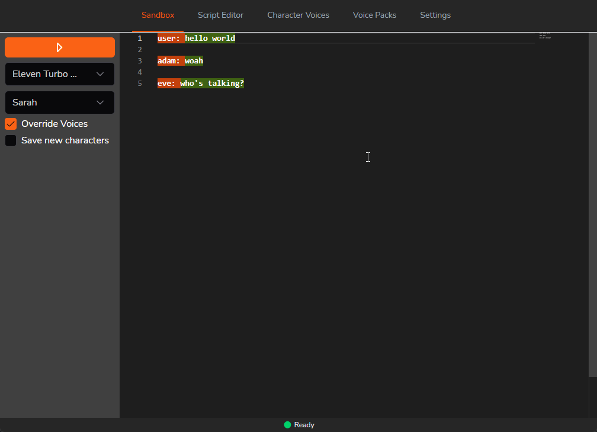

# Narration Studio

## About

Give a voice to everyone & everything! Games, software, videos.
A tool that unifies many different text-to-speech engines into one graphical user interace. Create scripts, try out TTS
engines, and more coming soon.
At the moment only basic capabilities are enabled for each engine, but the plan is to integrate all of the features
available for each.

The objective of this project is to provide a nice interface to use many TTS engines simultaneously. The next step will
be providing an easy way to enable TTS in any game or software,
and if it's feasible to provide OCR capabilities to enable it in games that aren't easily moddable.

Built in Go using [wails.io](https://wails.io), Vue + Typescript.

## Features

* Local & API TTS engines
* Create & Modify audio scripts
* Preview TTS engines and their available voices
* Server mode to provide TTS via http

## Currently Supported TTS Engines:

* [Piper](https://github.com/rhasspy/piper)
* [Microsoft Speech Api 4 (Windows Only)](https://en.wikipedia.org/wiki/Microsoft_Speech_API)
* [ElevenLabs](https://elevenlabs.io/docs/api-reference/text-to-speech)
* [OpenAI TTS](https://platform.openai.com/docs/guides/text-to-speech)
* [Google Cloud](https://cloud.google.com/text-to-speech)
* [Google Gemini API](https://ai.google.dev/gemini-api/docs/speech-generation)

### _Upcoming Features:_

* Command line mode to provide TTS through stdio
* Twitch, Kick integration for streaming
* OCR to TTS
* TBA

## Live Development

Narration Studio uses Wails v3. Install its CLI with
`go install github.com/wailsapp/wails/v3/cmd/wails3@v3.0.0-alpha.98`, then run `wails3 dev` in the project directory.
It runs the Vite development server with hot reload of your frontend changes and rebuilds the app when a `.go` file
changes.

## Building

Build Piper's native library first (`scripts/build-libpiper.ps1` on Windows, `scripts/build-libpiper.sh` elsewhere),
then:

* Windows: `scripts/build.ps1` builds the app, the CLI and the NSIS installer (needs NSIS and the `wails3` CLI).
* macOS: `scripts/build-osx.sh` builds a universal `Narration Studio.app` with the CLI inside.
* Linux: `scripts/build.sh [gtk4|gtk3]` builds the app and the CLI for GTK 4 + WebKitGTK 6.0
  (`libgtk-4-dev libwebkitgtk-6.0-dev`) or GTK 3 + WebKit2GTK 4.1 (`libgtk-3-dev libwebkit2gtk-4.1-dev`), plus
  `libasound2-dev`.
